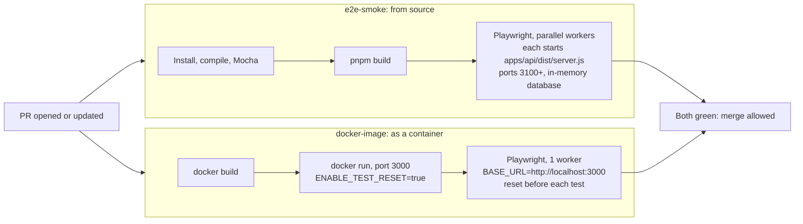
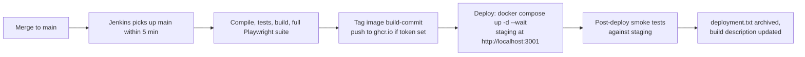

# CI/CD: how the pieces fit together

This document explains what runs when, in which system, and why. It records the design discussion behind two GitHub Actions jobs that check each pull request, a Jenkins pipeline, and delivery to staging. It describes the files as they are today and marks anything that is only a proposal.

## In one paragraph

When a pull request is opened or updated, **GitHub Actions** runs two fast checks in parallel: the app run **from source** and the app run **as a container**. Both end with Playwright smoke tests, and both are intended to be required checks that can block a merge. **Jenkins** runs separately on a local controller. It runs a broader pipeline on branches and PRs, and after a merge to `main` it also publishes an image, deploys it to **staging**, and verifies the deployment. There is no production stage.

## The systems

| | GitHub Actions | Jenkins |
|---|---|---|
| Defined in | `.github/workflows/pr-quality-gate.yml` | `Jenkinsfile`, with the controller defined in `jenkins/` |
| Runs on | GitHub-hosted `ubuntu-latest` runners | A local container on your machine (`jenkins/docker-compose.yml`) |
| Triggered by | Every PR opened, updated or reopened against `main` | Polling GitHub every 5 minutes for branches and PR merge builds |
| Can block a merge | Yes, as required status checks in the repository's branch ruleset | No. Its token is read-only, so results are not posted to GitHub |
| Playwright scope | 3 `@smoke` tests | Full suite (UI and API projects) |
| After merge | Nothing | Publish, deploy to staging, post-deploy smoke |

## The two PR-open flows (GitHub Actions)

Both jobs start together. Neither has a `needs:` key, so they run in parallel on separate runners.



| | `e2e-smoke` (source) | `docker-image` (container) |
|---|---|---|
| Question it answers | Does the code build and pass its tests? | Does the shippable image start, stay healthy and behave correctly? |
| App under test | Plain Node processes from the build output | The Docker image, run as a container |
| Compile and Mocha | Yes | No |
| Data isolation | One in-memory database per Playwright worker | One shared database, reset before each test |
| Workers | Parallel (per-worker servers) | 1 (shared database) |
| Fixture behaviour | Worker-scoped fixture starts and stops the servers | `BASE_URL` points at the container; `ALLOW_TEST_RESET=1` lets the reset endpoint run |
| Artifact name | `playwright-diagnostics` | `playwright-diagnostics-container` |

**Why both:** the source run checks the code, and the container run checks the packaging, which is what staging actually runs. A broken `Dockerfile` or a file missing from the image shows up only in the container run. The `docker-image` job keeps that name for continuity with the existing required check, even though it now also runs tests.

**Why a container at all:** a deployed service runs an image, not a clone. The image bundles the code, the Node runtime, the dependencies and the built frontend, so the artifact that passed CI is the one that runs in staging. Source control stays the source of truth, and the image is built from it by the `Dockerfile`.

## Jenkins pipeline

`Jenkinsfile`, run by a multibranch job that `jenkins/casc/jenkins.yaml` creates automatically.

| Stage | Branches and PRs | `main` only | Tests what |
|---|---|---|---|
| Prepare | Yes | | Installs dependencies, computes a Docker-safe build id and a version (`<build>-<commit>`) |
| Compile | Yes | | TypeScript type checks |
| Unit tests | Yes | | Mocha, with JUnit output |
| Build | Yes | | Production build of the web app and API |
| Container image | Yes | | Builds the image, starts it, waits for its health check. No browser tests |
| Playwright E2E | Yes | | Full suite against per-worker source servers (Chromium) |
| Publish image | | Yes | Tags the version; pushes to `ghcr.io` if `GHCR_TOKEN` is set, otherwise skips the push |
| Deploy to staging | | Yes | `docker compose -f docker-compose.staging.yml up -d --wait` |
| Post-deploy smoke | | Yes | `@post-deploy` Playwright tests against the staging stack |

After every build: publish JUnit results, save the container log, write `deployment.txt` (on `main`), archive reports and traces, remove the container and image, and clean the workspace.

Settings that shape it:
- **One executor.** The Playwright workers use fixed ports, so builds must not overlap.
- **Discovery.** Branches and PR merge builds are discovered, and a branch that already has a PR is not built twice.
- **Polling.** Webhooks would need a Jenkins that GitHub can reach, so it checks GitHub every 5 minutes instead.
- **Per-job concurrency.** A newer build of the same branch aborts an older one.

### What to expect per branch

Jenkins creates one job per branch under `quality-gate-lab`, and each job builds independently.

| Branch | Stages that run | Stages skipped | Meaning of green |
|---|---|---|---|
| Feature or release branch (for example `release/ui-refresh-aidlc`) | Prepare through Playwright E2E | Publish image, Deploy to staging, Post-deploy smoke (`when { branch 'main' }`) | The code is healthy. Nothing is deployed. |
| `main` (after a merge) | Every stage | None | Staging runs the merged commit and `@post-deploy` passed. |

- The branch build is advisory and overlaps the GitHub checks. Only GitHub can block a merge.
- A `main` build appears within 5 minutes of the merge (the polling interval). **Build Now** on the `main` job skips the wait.
- Staging is identified by the image tag `<build>-<commit>`. Compare it with the merge commit.

Messages that look alarming but are expected:
- `Could not update commit status ... 403`: the read-only token cannot post statuses to GitHub.
- `Stage "X" skipped due to earlier failure(s)`: an earlier stage (for example Prepare) failed, so later ones did not run. A first build right after Jenkins starts can fail this way; the next build normally passes.
- `ERROR: No build record ... could not be located`: a Jenkins cosmetic message after a failed first build.

## After the merge: staging



- **Staging is not a branch.** It is a running Docker Compose stack (`qgl-staging`, `docker-compose.staging.yml`) on your machine's Docker, on port 3001, with its own persistent volume. Nothing merges into it. Jenkins deploys the image it just built.
- **Why Jenkins can do this:** its container mounts the host's Docker socket, so its `docker` commands start containers beside it on your Docker, not inside it. It reaches staging as `host.docker.internal:3001`.
- **The reset endpoint is off in staging**, and a post-deploy test asserts that `POST /api/test/reset` returns 404. The test fixture never resets an external `BASE_URL` unless `ALLOW_TEST_RESET` is set, which only the CI container job does.
- **The deployment record** is `deployment.txt` (version, image, commit, URL, result) in the build's artifacts, plus the build description.
- **There is no production stage.** The usual next step would be a manual approval, then deploying the same tested image. The image is promoted, not rebuilt.

## Which Compose file does what

| File | Used by | Started by |
|---|---|---|
| `jenkins/docker-compose.yml` | Runs Jenkins itself on port 8080 | You, by hand |
| `docker-compose.yml` (root) | Local app on port 3000 | You, with `./build.sh docker` |
| `docker-compose.staging.yml` | Staging deploy on port 3001 | Jenkins, `main` builds only |

The GitHub jobs and Jenkins' "Container image" stage do not use Compose. They use `docker build` and `docker run` directly.

## Who can see what

- **GitHub shows** only the GitHub Actions checks. Jenkins' results live only in Jenkins, because its token is read-only and cannot post commit statuses.
- **To make Jenkins a required check** (a common enterprise pattern, where GitHub enforces policy and Jenkins does the work and reports back), the token needs **Commit statuses: Read and write**, and the Jenkins check must be added to the required list.
- **Duplication is deliberate.** Compile, Mocha and the image health check run in both systems, so each can be demonstrated on its own. Many companies would pick one system for PR checks.

## Credentials

| Secret | Where it lives | Needed for |
|---|---|---|
| Jenkins admin password | `jenkins/.env` (git-ignored) | Logging in to the local Jenkins |
| `GITHUB_TOKEN` | `jenkins/.env` | Fine-grained, read-only token (contents, pull requests, metadata) so Jenkins can discover branches and PRs |
| `GHCR_TOKEN` | `jenkins/.env`, optional | Classic token with `write:packages` to push images to `ghcr.io`. Leave empty to skip the push; staging then uses the locally built image |

GitHub Actions uses no secrets. Changes to `jenkins/.env` take effect only after the Jenkins container is recreated (`docker compose -f jenkins/docker-compose.yml up --build -d`), because the credentials are created at startup.

## Running things locally

```
./build.sh                                       # install, compile, Mocha, build
pnpm --filter ai-ci-reference-e2e test           # full Playwright suite (per-worker source servers)
docker compose -f jenkins/docker-compose.yml up --build -d   # start Jenkins on http://localhost:8080
```

Reproduce the container PR job by hand:

```
docker build -t quality-gate-lab:ci .
docker run -d --name qgl -p 3000:3000 -e ENABLE_TEST_RESET=true quality-gate-lab:ci
cd e2e && BASE_URL=http://localhost:3000 ALLOW_TEST_RESET=1 pnpm exec playwright test --grep @smoke --workers=1
docker rm -f qgl
```

## Split-out projects

To keep each pipeline's output easy to digest, the flows were copied into standalone projects:

- `../qg-pr-open-container-playwright`: only the container PR flow (done). It has `README.pr-open-container.md` and a code-path walkthrough in `VERBOSE.pr-open-container.md`.
- `../qg-pr-open-e2e-playwright`: intended to hold only the source PR flow. It is still a full copy and has not been pared down yet.
- A separate Jenkins-only project may follow.

## Open decisions

- **Division of responsibility.** Proposed: GitHub Actions is the only PR gate. Jenkins runs on `main` for delivery plus a nightly cross-browser regression, and skips PR builds or runs a trimmed one. Not applied yet; Jenkins currently also builds PRs.
- **Nightly cross-browser run.** Not built. It needs Firefox and WebKit Playwright projects and a scheduled trigger.
- **Jenkins as a required check.** Needs the status-write permission described above.
- **Production.** Out of scope for now.
