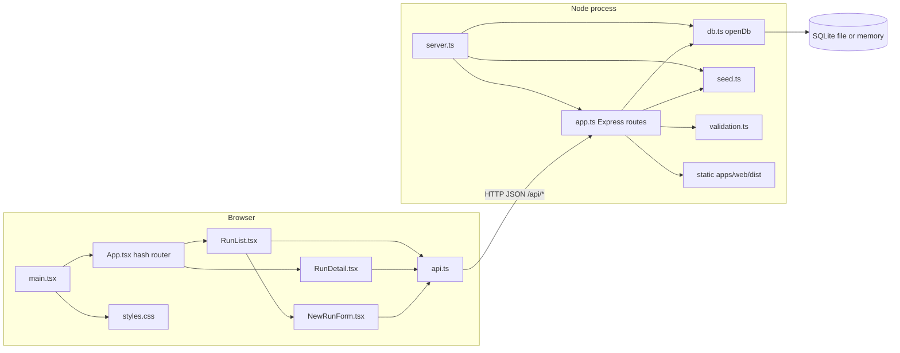
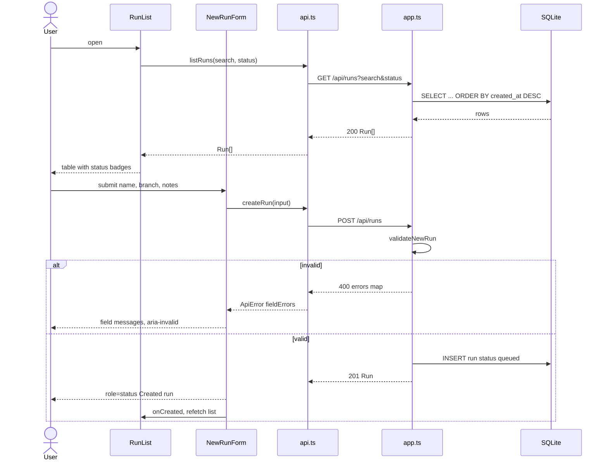
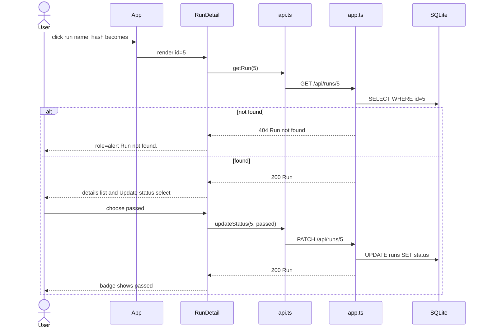

# Architecture — ai-ci-reference-dashboard

## Architecture Analysis

### System Overview

A pnpm monorepo with two runtime apps and one test package:

- `apps/web` (`@qgl/web`): a React 19 single-page app built by Vite into static files.
- `apps/api` (`@qgl/api`): an Express 5 server on Node with an embedded SQLite database (`node:sqlite`). It serves the REST API and, in production, the built SPA from `apps/web/dist`.
- `e2e` (`ai-ci-reference-e2e`): Playwright UI and API suites that run against the built API server or a deployed URL.

The delivery tooling has three parts: a Docker image, a GitHub Actions PR gate, and a Jenkins pipeline that deploys to staging. `component-inventory.md` lists every component.

### Architectural Style

The app is a **modular monolith** with one deployable process. The API and static SPA hosting share one Express app and one container (`Dockerfile`, `CMD node apps/api/dist/server.js`). In development the two run separately: the Vite dev server (5173) proxies `/api` to the API (3000), as configured in `apps/web/vite.config.ts`. There is no service layer and no repository layer: route handlers in `apps/api/src/app.ts` run SQL directly.

The frontend has no router library, state library, or UI library. `App.tsx` does hash routing by hand. Each view keeps local `useState` and calls a thin `fetch` wrapper (`api.ts`). One global stylesheet (`styles.css`) provides all styling.

### Component Relationships

Text fallback: `main.tsx` mounts `App` and imports `styles.css`. `App` picks `RunList` or `RunDetail` from the URL hash. `RunList` embeds `NewRunForm`. All three views call `api.ts`, which sends JSON over HTTP to `/api/*` routes in `app.ts`. `server.ts` opens the SQLite DB through `db.ts`, seeds it if empty through `seed.ts`, and starts `app.ts`. `app.ts` validates input with `validation.ts`, queries SQLite, and serves the built SPA as static files.

### Data Flow

1. The browser loads `index.html` and the bundle, either from Express static hosting (prod/container) or from the Vite dev server.
2. Views call `/api/runs...`. The API validates the request, runs prepared SQL against the `runs` table, and returns camelCase JSON. The column aliasing lives in `RUN_COLUMNS` in `db.ts`.
3. On mutation, the views update local state from the response. `RunDetail` replaces its run. After a create, `RunList` refetches by bumping `reloadKey`.
4. Errors reach the UI as `ApiError` (message plus optional `fieldErrors`) and render as `role="alert"` or per-field messages.

### Key Design Decisions

| Decision | Implication |
|---|---|
| One process serves the API and the SPA | One image and one port make deployment simple. The UI cannot ship separately from the API. |
| Built-in `node:sqlite`, synchronous | No ORM and no native addon. Requires a recent Node (image uses 24). Persistence is a file path or `:memory:`. |
| Hash routing, no router library | Deep links work with no server fallback. Only two routes. |
| Global CSS, no design system | The restyle has very little surface to change, and no tokens or theme exist to build on. |
| Accessibility-first markup (roles, labels, `aria-*`) | The e2e suite locates elements by role and name, so the semantics are a hard contract. |
| Test-reset endpoint behind an env flag | Deterministic e2e runs. It must stay disabled in deployed environments, and a post-deploy test asserts that. |

### Improvement Opportunities

- Add a theming layer (CSS custom properties or a token file) before restyling, so status colours and surfaces are defined in one place. This matters most for the modern-ui-refresh intent.
- Share the `Run`/`Status` types between web and API. They are defined separately in each.
- Debounce the search input. Add a component-test layer and a lint/format toolchain for the web app.
- Optionally add visual-regression snapshots in Playwright to protect the refreshed look.

## Interaction Diagrams

### List, filter, and create a run

Text fallback: the user opens the list or changes filters. `RunList` calls `listRuns`, which sends `GET /api/runs`. The API queries SQLite newest-first and returns the runs, and the table renders. On form submit, `NewRunForm` posts to `/api/runs` and the API validates. Invalid input returns 400 with field errors, which appear beside the inputs. Valid input is inserted as `queued`, returns 201, shows a status message, and makes `RunList` reload.

### View a run and change its status

Text fallback: clicking a run link changes the hash, and `App` renders `RunDetail`, which fetches `GET /api/runs/:id`. A missing run shows an alert. Otherwise the details render. Picking a new status sends `PATCH /api/runs/:id`, and the returned run replaces local state. On failure, an alert reads "Unable to update the status."
