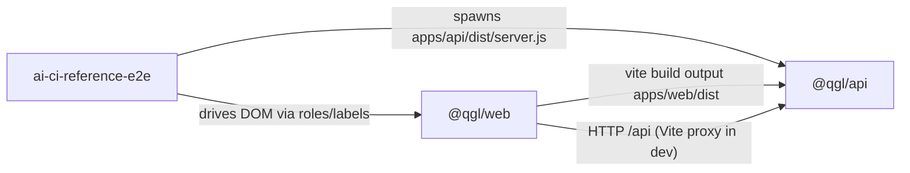

# Dependencies — ai-ci-reference-dashboard

## External Dependencies by Package

| Package | Runtime deps | Dev deps |
|---|---|---|
| `quality-gate-lab` (root) | none | none |
| `@qgl/web` | `react` ^19.3.0, `react-dom` ^19.3.0 | `@types/react` ^19.3.0, `@types/react-dom` ^19.3.0, `@vitejs/plugin-react` ^6.1.2, `typescript` ^7.0.2, `vite` ^8.3.4 |
| `@qgl/api` | `express` ^5.3.0 | `@types/chai` ^5.2.3, `@types/express` ^5.0.6, `@types/mocha` ^10.0.10, `@types/node` ^26.6.5, `chai` ^6.3.0, `mocha` ^12.0.3, `tsx` ^4.23.15, `typescript` ^7.0.2 |
| `ai-ci-reference-e2e` | `find-up-simple` ^1.0.1 | `@playwright/test` ^1.64.1, `@types/node` ^26.6.5, `typescript` ^7.0.2 |

`pnpm-workspace.yaml` allows install scripts for `esbuild` only (`allowBuilds`). The lockfile is committed, and CI installs with `--frozen-lockfile`.

**Styling dependencies: none.** The web app has no CSS, UI, or icon packages, so a restyle that adopts a library would add the first one. See `technology-stack.md` § Styling and Theming.

## Platform and Service Dependencies

- Node built-ins: `node:sqlite`, `node:fs`, `node:path`, `node:url`, `node:child_process`, `node:crypto`.
- Docker images: `node:24-slim` (app), `jenkins/jenkins:lts-jdk21` (CI controller).
- GitHub Actions: `actions/checkout@v7`, `pnpm/action-setup@v6`, `actions/setup-node@v7`, `actions/upload-artifact@v7`.
- Jenkins plugins (`jenkins/plugins.txt`): configuration-as-code, job-dsl, workflow-aggregator, git, github-branch-source, junit, credentials-binding, timestamper, ws-cleanup, pipeline-stage-view.
- Registry: `ghcr.io/davidlescard/ai-ci-reference-dashboard`. Pushing is optional.

## Internal Cross-Package Dependencies

No package imports another through `workspace:` links. Packages couple at run and build time only:

Text fallback: the API serves the web build from `WEB_DIST`. The e2e fixture spawns the built API server, so `apps/web` and `apps/api` must be built before e2e runs. The e2e page objects depend on the web DOM's accessible names and structure. In development the web app reaches the API through the Vite `/api` proxy.

## Duplicated Definitions

`Run`, `Status`, and `STATUSES` are declared in both `apps/web/src/api.ts` and `apps/api/src/db.ts`, and again as `RunStatus` / `RUN_COLUMNS` in `e2e/src/pages/dashboard.page.ts`. A change in one place must be repeated in the others by hand.
