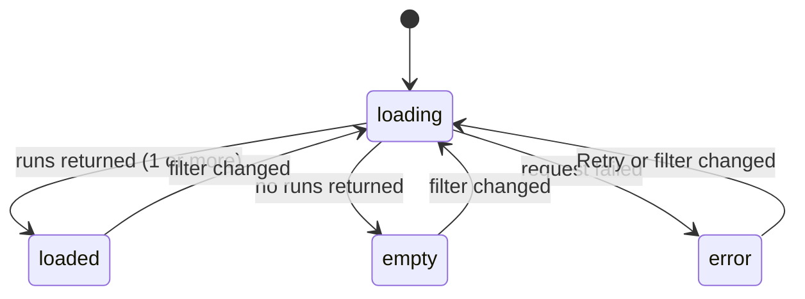
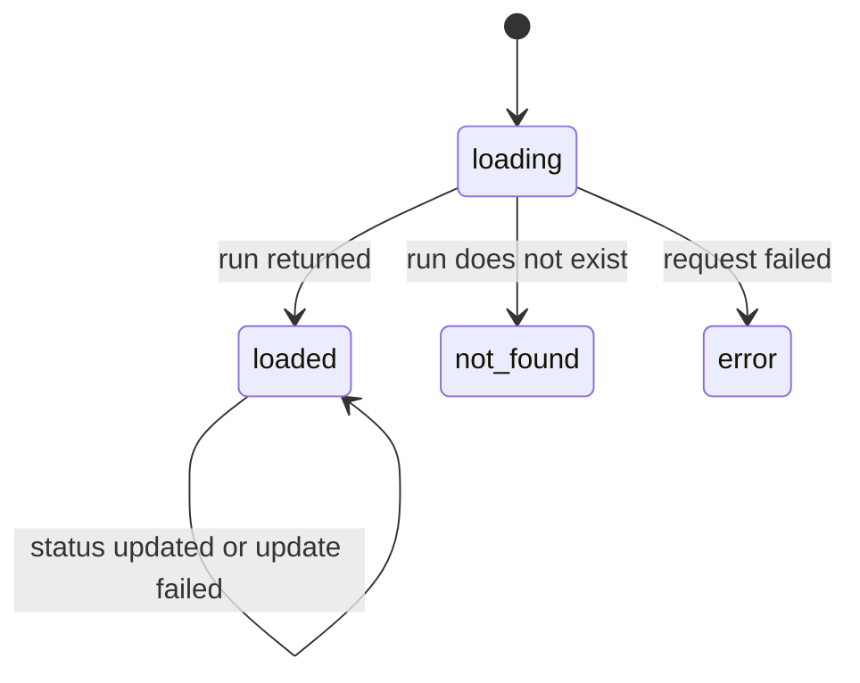
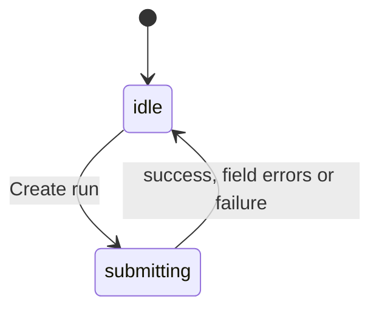
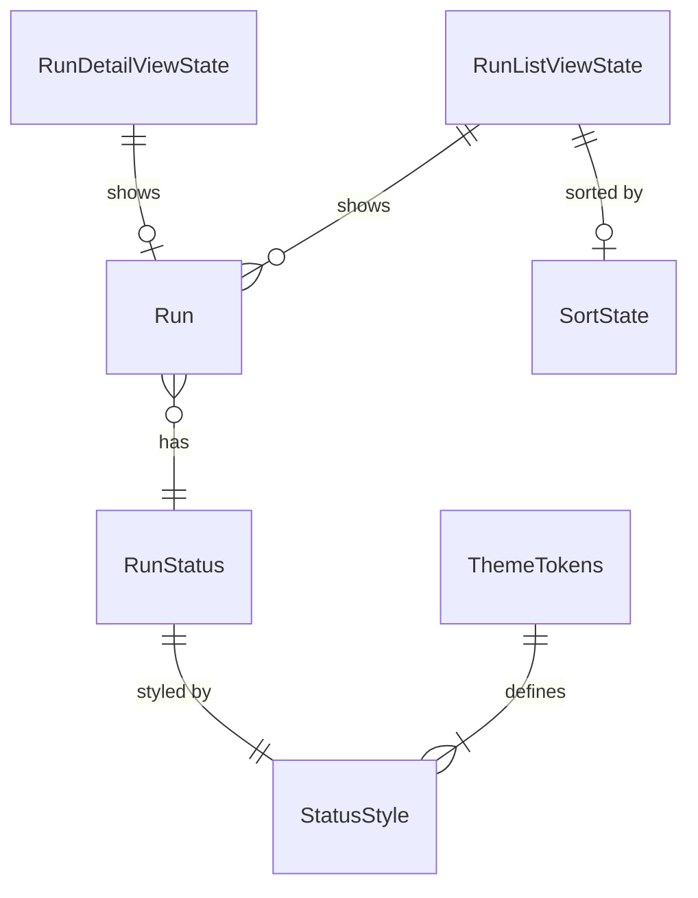

# Functional Specification — modern-ui-refresh

Source of truth for the screen workflows and state transitions of the refreshed dashboard. Inputs: [requirements.md](../../inception/requirements-analysis/requirements.md) (FR1–FR7, NFR1–NFR5), the functional design answers ([functional-design-questions.md](./functional-design-questions.md)), and the existing code described in the codekb (`component-inventory.md`, `code-quality-assessment.md` § UI Refactor Constraints). This refactor plan has no unit-of-work or component design. The existing `apps/web` screens act as the domain design, and this work changes only how they look.

## Scope

- **Changes:** the look, layout and formatting of the three existing screens (runs list with its create form, and run detail) plus a new header bar.
- **Unchanged:** routes (`#/` and `#/runs/{id}`), API calls, request and response data, control names, messages and ARIA roles (BR8.1).

## Screens

| Screen | Route | Cards (top to bottom) |
|---|---|---|
| Runs list | `#/` (any hash that is not a run route) | 1. "Test runs" card: filters, state message, table. 2. "Create test run" card: form |
| Run detail | `#/runs/{id}` | 1. Detail card: back link (shown in every state), heading, label/value list, Update status |

Every screen sits under the header bar (BR2.1), in one centered column at most 1100px wide on a `#F8FAFC` page (BR2.2). The existing `h2` headings ("Test runs", "Create test run", the run name) and their `aria-labelledby` sections stay the same (BR5.1).

## Workflows

### WF1 — Browse, filter and sort runs (BR3.1–BR3.6, BR4, BR7.1)
1. The user opens `#/`. The list enters **loading** and shows "Loading runs..." (status) above the table area.
2. The list is requested with the current search text and status filter.
3. On success with runs, the list enters **loaded**. The table shows one body row per run: name link, branch, status badge, readable duration.
4. On success with no runs, the list enters **empty** and shows "No test runs match your filters." with no table.
5. On failure, the list enters **error** and shows one alert, "Unable to load test runs. Please try again.", with a Retry button.
6. Typing in "Search runs" or choosing a "Status" option goes back to step 1 with the new filter.
7. Activating a column header sorts ascending; activating the same header again flips the direction. Duration sorts on raw seconds.
8. Activating Retry goes back to step 1 with the same filters.

### WF2 — View a run (BR5.1, BR5.3, BR7.1, BR7.2)
1. The user activates a run name link and the route becomes `#/runs/{id}`.
2. Detail enters **loading** and shows "Back to runs" and "Loading run..." (status).
3. On success it enters **loaded** and shows the card: "Back to runs", heading (run name, `h2` with id `detail-heading`), then Branch, Status (badge), Duration (readable), Created (readable date), Notes ("None" when empty), then Update status.
4. If the run does not exist it enters **not-found** and shows "Back to runs" and "Run not found." (alert).
5. On any other failure it enters **error** and shows "Back to runs" and "Unable to load this run." (alert).
6. "Back to runs" or the header title returns to `#/` (WF1).

### WF3 — Update a run's status (BR5.2)
1. In the loaded detail card the user picks a value in "Update status".
2. The update is requested.
3. On success the card shows the returned run, including the new badge.
4. On failure the card shows "Unable to update the status. Please try again." (alert) and keeps the last known run.

### WF4 — Create a run (BR6.1, BR6.2)
1. The user fills in Name, Branch and optionally Notes in the "Create test run" card and activates "Create run".
2. The form enters **submitting**: the button is disabled and earlier messages are cleared.
3. On success: 'Created run "<name>"' (status) is shown, the fields are cleared, and the runs list reloads (WF1 step 1).
4. On field errors: each invalid field is marked invalid (`aria-invalid="true"`; valid fields keep `aria-invalid="false"`) and shows its message underneath.
5. On any other failure: "Unable to create the run. Please try again." (alert).
6. The form returns to **idle** and the button is enabled again.

## State machines

### Runs list (`RunListViewState.phase`)

Text fallback: loading goes to loaded, empty or error. A filter change from any state, or Retry from error, goes back to loading. Sorting changes only the row order and never changes the phase. While a reload is in progress after a successful load, the existing table stays visible and the loading status appears above it, never as a row inside it (BR3.5).

### Run detail (`RunDetailViewState.phase`)

Text fallback: loading goes to loaded, not-found or error. In loaded, a status update either replaces the run or sets the update error; the phase stays loaded. Changing the route id starts again at loading.

### Create run form

Text fallback: idle goes to submitting on Create run, and back to idle on any result, with the matching message shown.

## Responsive behavior (BR2.3)

| Viewport width | Filters | Form fields | Runs table |
|---|---|---|---|
| 600px and wider | Search and Status side by side | Name and Branch side by side, Notes full width below | Fits the card |
| Below 600px | Stacked, full width | Stacked, full width | Scrolls horizontally inside the card; the page never scrolls sideways |

## Visual acceptance values (resolves the R-06 open question)

These values settle the open questions in requirements.md and are the pass criteria for FR1.2, FR3.3 and NFR3.

| Item | Value | Rule |
|---|---|---|
| Accent | `#4F46E5` | BR1.1 |
| Page / card background | `#F8FAFC` / `#FFFFFF` | BR1.2 |
| Corner radius | 8px | BR1.2 |
| Border | 1px `#E2E8F0`, no shadow | BR1.2 |
| Row hover | `#F1F5F9` (slate-100) | BR3.3 |
| Header bar | `#4F46E5` background, white title text | BR1.1, BR2.1 |
| Focus ring | 2px `#4F46E5` (white on the header bar), 2px offset, keyboard focus only | BR1.5 |
| Typeface | Inter, system sans-serif fallback | BR1.3 |
| Status badge | queued `#475569` clock, running `#1D4ED8` sync, passed `#15803D` check-circle, failed `#B91C1C` error; white text; static icons | BR1.4, BR4.2 |
| Created date | medium date and short time in the browser locale, e.g. `Nov 8, 2026, 6:47 PM` | BR7.2 |
| Duration | `0s`, `45s`, `1m 25s`, `2m`, `1h 5m 3s` | BR7.1 |

## Test-sensitive pass criteria (resolves the R-05 open question)

- **Row counts:** the table body contains exactly one row per run shown. No placeholder, skeleton or progress rows (BR3.5).
- **Badge text:** the badge text is exactly the lowercase status value, both visible and accessible. No case transform, and the icon adds no text (BR4.2).
- **Names and roles:** all accessible names, messages and roles listed in BR2.1, BR3.1, BR3.2, BR3.4, BR5.1–BR5.3, BR6.1 and BR6.2 are unchanged.
- **Planned file changes (BR8.1):** `apps/web/**`, the root `pnpm-lock.yaml` (new dependencies; the build installs with `--frozen-lockfile`), and `e2e/**` page objects and specs per BR7.3. Nothing else.
- **Planned test edits (BR7.3):** the expected column list changes to `Name, Branch, Status, Duration`, and any assertion on raw duration seconds or a raw ISO date changes to the formatted value.

## Entity relationships (derived from entities.md)

Text fallback: ThemeTokens defines four StatusStyles, one per RunStatus. Each Run has one RunStatus. The list view state shows many runs and has an optional SortState. The detail view state shows at most one run. NewRunFormState stands alone.

## Rules summary (derived from rules.md)

| Group | Rules | Focus |
|---|---|---|
| BR1 | 1.1–1.8 | Theme tokens, contrast, focus, cleanup, bundle size |
| BR2 | 2.1–2.3 | Header, layout, responsive |
| BR3 | 3.1–3.6 | Runs list controls, table, states, sorting |
| BR4 | 4.1–4.2 | Shared status badge |
| BR5 | 5.1–5.3 | Run detail |
| BR6 | 6.1–6.2 | Create form |
| BR7 | 7.1–7.3 | Duration and date formatting, test updates |
| BR8 | 8.1–8.2 | Parity and build health |
